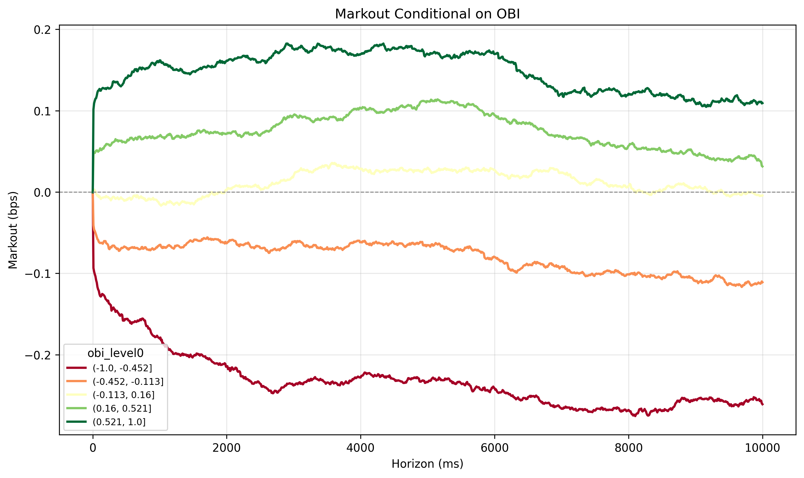
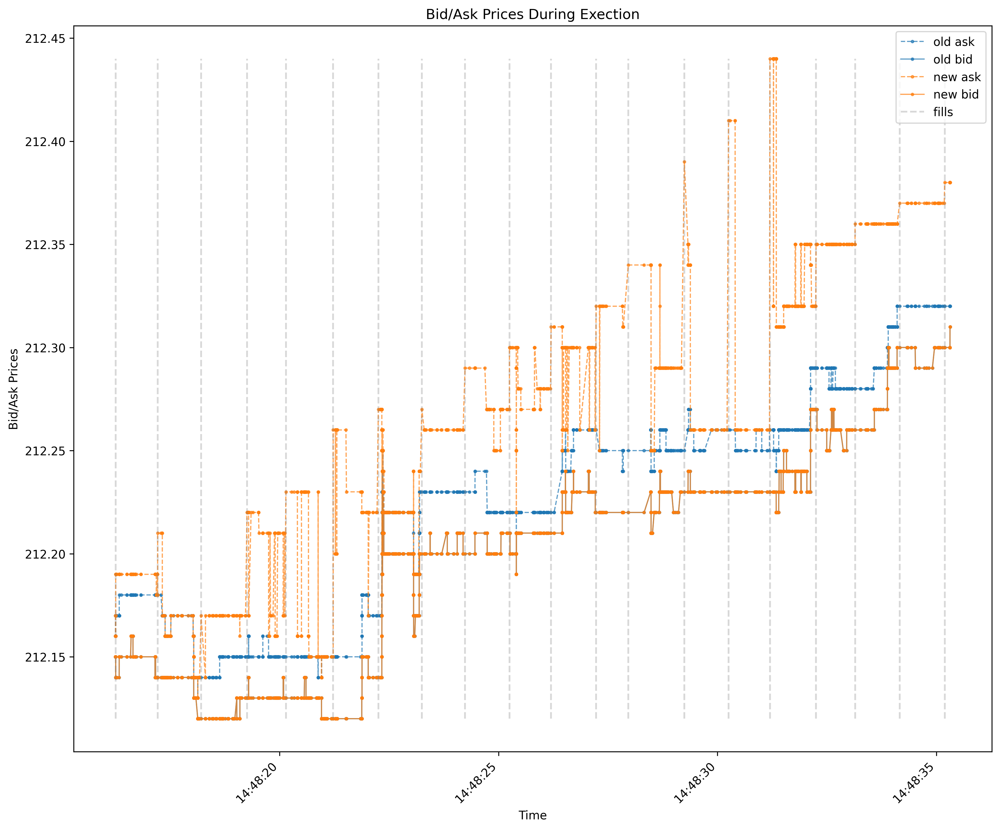
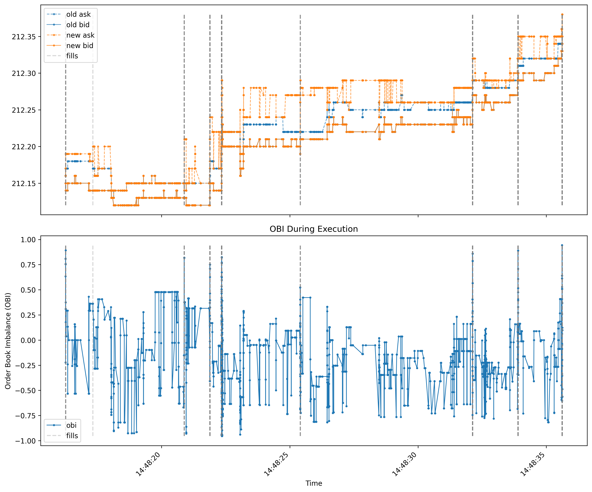

```{python}
#| echo: false
#| output: false
from dotenv import load_dotenv
import sys
sys.path.insert(0, '..')
import os
import databento as db
import numpy as np
import pandas as pd
import polars as pl
from saf_lib.helpers import DataBentoMBP10Adapter
from saf_lib.simulation import ExecutionSimulator
import matplotlib.pyplot as plt
load_dotenv()
```

# Abstract
A fundamental hurdle in trading is the balance between market impact and alpha decay. Submitting a large order leads to significant price impact as it takes the liquidity from the Limit Order Book (LOB). On the other hand, splitting a large order into smaller chunks over seconds or minutes exposes unexecuted orders to alpha decay and price drifts. This hurdle is especially prevalent in crowded markets where thousands of algorithms are trading on similar signals.

Our goal is to measure the average alpha lost when forced to split orders by comparing different execution strategies. This milestone report quanitifies our progress toward this goal. We use markout plots to analyze order book imbalance (OBI) as a predictor to help minimize the cost of chunking orders through price drifts and impact. We then build and validate an order execution simulator, and compare three execution strategies for a large-cap-small-tick equity.

# Goals for the Milestone
The goals we have set for this milestone report are as follows.

1. Build a data ingestion pipeline, which can parse L2 order book data from Databento for use in our ` ExecutionSimulator`. It should use caching for speed improvements and API savings.
2. Explore the effectiveness of order book imbalance (OBI) as a predictor of short term price movements via markout plots. We should use these plots to inform an execution strategy using OBI.
3. Write an `ExecutionSimulator` which can simulate the effects and performance of multiple execution strategies. It should be able to simulate multiple execution strategies, and the effects latency and limit order replenishment on the book.

# Sourcing Data

We are using the `MBP-10` schema from Databento, which provides the top 10 levels of the Limit Order Book (LOB) for a selection of stocks and date range. The dataset includes all order book updates (trades, adds, cancels, etc.) which allows us to reconstruct the market dynamics at a granular level. The data is sourced from [Databento](https://databento.com/docs/schemas-and-data-formats/mbp-10?historical=python&live=python&reference=python). We fetch data through a simple `MBP10DataAdapter` class that uses a hierarchical caching structure. This allows us to call the Databento API only when necessary, which is necessary for L2 book data. The adapter caches on `[tickers, start, end, dataset, schema]`. Here, our schema is always `MBP-10` and we use the `XNAS.ITCH` Dataset which gives us full access to the Nasdaq exchange.

We use L2 data for `AMZN` from `"2026-03-25":"2026-03-27"`. We are intentionally using a small time range and a single large-cap-small-tick stock in order to minimize runtime and memory requirements and maximize order book liquidity while we develop the simulator and strategies. Through the end of the project, we will add multiple assets spanning the large/small market cap and tick-size range to explore how different assets require different execution strategies.

# Markout Plots

The execution strategy we are building toward uses OBI to determine "good" or "bad" times to fill, and only fills at "good" times. However, first we need to explore how well OBI can separate the "good" and "bad" times to fill. We define order book imbalance (OBI) as:
$$
\begin{split}
OBI = \frac{Q_{bid} - Q_{ask}}{Q_{bid} + Q_{ask}}\in [-1, 1]
\end{split}
$$

OBI ranges from $[-1,1]$ and is known to be a good structural predictor of subsequent short-horizon returns. By capturing the relative quantity at the best bid and ask, OBI indicates which level will likely deplete fastest as aggressive orders arrive. To explore OBI's predictive power, we use markout plots. For each of five ranges of OBI values, we sample 100,000 start times and calculate the difference between the initial mid-price and the mid-price at 10,000 subsequent times, then average over each of the 100,000 paths. We use a time horizon of $[0,10]$ seconds, in milliseconds.

{fig-align="center" width=70%}

We can clearly see that OBI is a good predictor of price direction within a few milliseconds and that this price motion is structural, indicated by the length of time that the prices take to revert. In fact, for $|OBI| \in [0.5, 1]$ the price does not on average revert. This gives good grounding for OBI's use in our execution strategy.

# Execution Simulator

Our final goal for the milestone is to have built an `ExecutionSimulator` class which can:

1. Simulate the execution of market orders and immediate-or-cancel (IOC) limit orders at a given nanosecond timestamp and latency.
2. Maintain an orderbook state over time, using L2 data from the `MBP10DataAdapter`, consistent with mutations of the book caused by simulated fills and the replenishment of the book via a Poisson process.
3. Simulate three filling strategies of a large parent order(Q>10,000):
    1. Immediate/Naive: Attempt to fill the entire large order at once, sweeping all 10 levels.
    2. Constant Rate Naive: Split the parent into $n$ chunks of size $q/n$ and execute them $\delta t$ seconds apart, at a constant rate.
    3. OBI-Aware: Fill child orders of quantity `max_size` only when $|OBI| > threshold$ (positive for buys, negative for sells). This ensures the child orders fill only when the price is at a local minimum (buys) or maxiumum (sells).

To achieve these goals we wrote the `ExecutionSimulator` class which initiates the L2 book with a `polars` dataframe in Databento's `MBP-10` schema. The simulator maintains the book using internally consistent `numpy` arrays, which it updates as the book changes with after simulated fills. At the end of a simulation it returns a new `polars` dataframe representing the mutated book over time, as well as a dictionary of the form below. Note that `arrival_cost` is calculated as the `vwap` minus the mid price at execution.
```{python}

my_dict = {'vwap': 211.9365352112676,
 'fills': [(211.93, 246), (211.94, 464)],
 'total_filled': 710,
 'levels_swept': 1,
 'executed_at_ns': 1774538471626080001,
 'executed_at_idx': 4078073,
 'arrival_cost': 0.02153521126757596}
```

## Validation via Latency and Replenishment
To verify that the `ExecutionSimulator` works as expected, we run the constant fill strategy with different latencies and replenishment rates. The results below verify that lower latency and higher replenishment rate results in less impact and better fills, and vice versa, as expected. 
```{python}
#| echo: false
#| output: false
adapter = DataBentoMBP10Adapter(api_key=os.environ["DATABENTO_API_KEY"])
raw_data = adapter.get_data(
    tickers=["BKNG", "AMZN", "DRH"],
    start_date="2026-03-25",
    end_date="2026-03-27",
    dataset="XNAS.ITCH",
    cache_only=False
)

symbol_map = {853 : "AMZN", 4576:"DRH", 2021:"BKNG"}
df = pl.from_pandas(raw_data)
# Returns an Int64 column of nanoseconds
df = df.with_columns(
    pl.col("ts_event").dt.timestamp("ns").alias("ts_event_nano")
)

cols = ["ts_event_nano", "instrument_id"] + [
    col for n in range(0, 10)
    for col in [f"bid_px_{str(n).zfill(2)}", f"ask_px_{str(n).zfill(2)}", f"bid_sz_{str(n).zfill(2)}", f"ask_sz_{str(n).zfill(2)}"]
]

df = df.select(cols)
df = df.unique(subset="ts_event_nano", keep="last").sort("ts_event_nano")

old_df = df.filter(pl.col("instrument_id") == 853)
old_df = old_df.with_columns(((pl.col("ask_px_00") + pl.col("bid_px_00")) / 2).alias("mid"))
```
```{python}
#| echo: false
# --- Best ---
LATENCY = 0
RATE = 100
sim = ExecutionSimulator(old_df, latency_ns=LATENCY, replenishment_rate=RATE)
costs = []
for i in range(0, 10):
    ts = old_df.sample()["ts_event_nano"][0]
    results, new_df = sim.constant_fill("BUY", 10_000, ts, wait_ns=1e9, n_chunks=20)
    p0=old_df.filter(pl.col("ts_event_nano") == ts)['mid'][0]
    filled = np.sum([r["total_filled"] for r in results if r["vwap"] != 0.0])
    total_cost = np.sum([r["vwap"] - p0 for r in results if r["vwap"] != 0.0])
    summed_arrival_cost = np.sum([r["arrival_cost"]for r in results if r["vwap"] != 0.0])
    costs.append({
        "filled": filled,
        "total_cost": total_cost,
        "summed_arrival_cost": summed_arrival_cost
    })
print("="*30)
print(f"Latency (ms): {LATENCY / 1e6}")
print(f"Poisson Replenishment Rate: {RATE}")
costs = pl.DataFrame(costs)
print(f"Mean Total Cost: {costs.mean()["total_cost"][0]:.2f}")
print(f"Mean Summed Arrival Cost: {costs.mean()["summed_arrival_cost"][0]:.2f}")

# --- Middle ---
LATENCY = 5_000_000
RATE = 10
sim = ExecutionSimulator(old_df, latency_ns=LATENCY, replenishment_rate=RATE)
costs = []
for i in range(0, 10):
    ts = old_df.sample()["ts_event_nano"][0]
    results, new_df = sim.constant_fill("BUY", 10_000, ts, wait_ns=1e9, n_chunks=20)
    p0=old_df.filter(pl.col("ts_event_nano") == ts)['mid'][0]
    filled = np.sum([r["total_filled"] for r in results if r["vwap"] != 0.0])
    total_cost = np.sum([r["vwap"] - p0 for r in results if r["vwap"] != 0.0])
    summed_arrival_cost = np.sum([r["arrival_cost"]for r in results if r["vwap"] != 0.0])
    costs.append({
        "filled": filled,
        "total_cost": total_cost,
        "summed_arrival_cost": summed_arrival_cost
    })
print("="*30)
print(f"Latency (ms): {LATENCY / 1e6}")
print(f"Poisson Replenishment Rate: {RATE}")
costs = pl.DataFrame(costs)
print(f"Mean Total Cost: {costs.mean()["total_cost"][0]:.2f}")
print(f"Mean Summed Arrival Cost: {costs.mean()["summed_arrival_cost"][0]:.2f}")

# --- Worst --- 
LATENCY = 10_000_000_000
RATE = 0
sim = ExecutionSimulator(old_df, latency_ns=5_000_000, replenishment_rate=RATE)
costs = []
for i in range(0, 10):
    ts = old_df.sample()["ts_event_nano"][0]
    results, new_df = sim.constant_fill("BUY", 10_000, ts, wait_ns=1e9, n_chunks=20)
    p0=old_df.filter(pl.col("ts_event_nano") == ts)['mid'][0]
    filled = np.sum([r["total_filled"] for r in results if r["vwap"] != 0.0])
    total_cost = np.sum([r["vwap"] - p0 for r in results if r["vwap"] != 0.0])
    summed_arrival_cost = np.sum([r["arrival_cost"]for r in results if r["vwap"] != 0.0])
    costs.append({
        "filled": filled,
        "total_cost": total_cost,
        "summed_arrival_cost": summed_arrival_cost
    })
print("="*30)
print(f"Latency (ms): {LATENCY / 1e6}")
print(f"Poisson Replenishment Rate: {RATE}")
costs = pl.DataFrame(costs)
print(f"Mean Total Cost: {costs.mean()["total_cost"][0]:.2f}")
print(f"Mean Summed Arrival Cost: {costs.mean()["summed_arrival_cost"][0]:.2f}")
```

## Initial Execution Comparison
After verifying the correctness of the `ExecutionSimulator`, we can briefly compare strategies. Plots of these execution results can be found at @fig-execution in @sec-appendix. All three strategies ran with 5ms latency, replenishment rate of $\lambda = 10$, and a parent buy order for 10,000 shares. The naive execution could only fill 2,432/10,000 shares, and the repeated naive execution filled all 10,000 with a total cost of of $2.5, calculated as the sum of the difference between each fill's VWAP and the mid-price at the time of execution, and a summed arrival cost of $1.5. The OBI-aware strategy improved on this with a total cost of $2.1 and a summed arrival cost of $0.53. 


# Goals for the Future

Beyond the milestone, our main goals are to:

1. Improve on the OBI-aware execution strategy by taking into account other aspects of the book (trade-sign auto correlation, momentum, etc.)
2. Widen the number and type of assets we use to include large and small market cap and tick size stocks, and explore how each requires its own tweaks on the execution strategy.
3. Add alpha forecasts, so that the execution strategy is acting on a specific forecast.

# Citations and Plots {#sec-appendix}

::: {#fig-execution layout="[[1,1], [1]]"}

{#fig-immediate}

{#fig-constant}

{#fig-obi width=60%}

Comparison of Execution Strategies
:::

## References

- Bouchaud, J. P., Farmer, J. D., & Lillo, F. (2009). How markets slowly digest changes in supply and demand. *Handbook of Financial Markets*.
- Cont, R., Kukanov, A., & Stoikov, S. (2014). The price impact of order book events. *Journal of Financial Econometrics*.
- Said, E. (2022). Market Impact: Empirical Evidence, Theory and Practice. *arXiv preprint*.
- Sato, Y., & Kanazawa, K. (2024). Online Learning of Order Flow and Market Impact with Bayesian Change-Point Detection Methods. *arXiv preprint*.
- Obizhaeva, A. A., & Wang, J. (2013). Optimal trading strategy and supply/demand dynamics. *Journal of Financial Markets*, 16(1), 1–32.
- Gârleanu, N., & Pedersen, L. H. (2013). Dynamic trading with predictable returns and transaction costs. *Journal of Finance*, 68(6), 2309–2340.
