# Abstract

problem (naive fills = bad) -> goals (use OBI to improve things) -> methods (obi informs aggression) -> results -> significance (?)
Definitions of key terms and calculations is provided in @sec-definitions.


# Motivation and Main Ideas
<!-- Michael CN -->

A fundamental hurdle in medium-frequency systematic trading is the balance between arrival cost and immediacy. Submitting a very large marketable order leads to significant price impact as it takes liquidity from the limit order book. On the other hand, splitting a parent order into smaller chunks over seconds or minutes exposes child fills to adverse price drifts, and when done naively also leads to significant price impact. The goal of this work is to reduce the total arrival cost of a parent order by intelligently calibrating the aggression of child orders to take advantage of favorable price movements while avoiding unfavorable ones.

## Underperformance of Naive Splitting
Unfortunately, naively splitting a parent order into $n$ chunks and filling them as market orders $\delta t$ time units apart has high impact and exposes the parent order to significant price drifts. The below example of splitting a 5000-share order into twenty-five 200-share buy fills shows the significant impact of repeatedly lifting the ask overtime. The underperformance of this strategy nessesitates a more intelligent way to split and fill large orders.
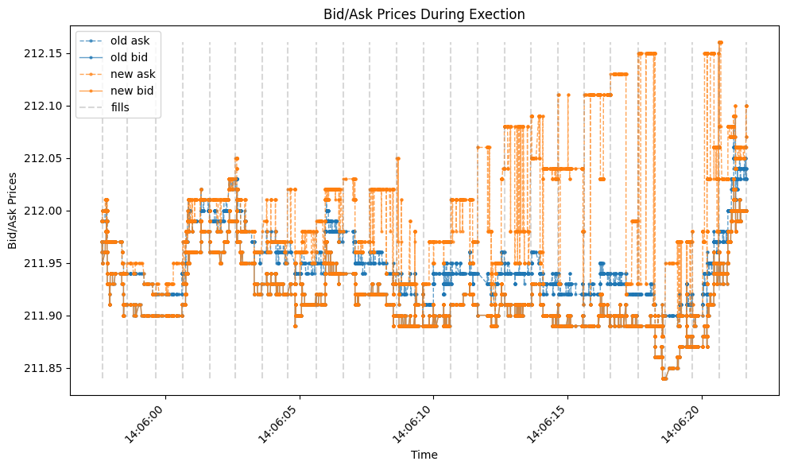{#fig-naive fig-align="center" width=70%}

## Book Imbalance as a Primary Signal
We chose to use the imbalance in quantity on the top six levels of the book as our signal to calibrate the aggression of our fill strategy. We made this choice because OBI is a well understood, easy to implement, and  powerful signal of price direction on the micro-milli second time scale. To explore OBI's predictive power, we used the markout plot below. Within five separate ranges of OBI values, we sample 100,000 timestamps and calculate the difference between the initial mid-price and the mid-price at 10,000 subsequent times, then average over each of the 100,000 paths. We use a time horizon of $[0,1]$ second, in tens of microseconds.

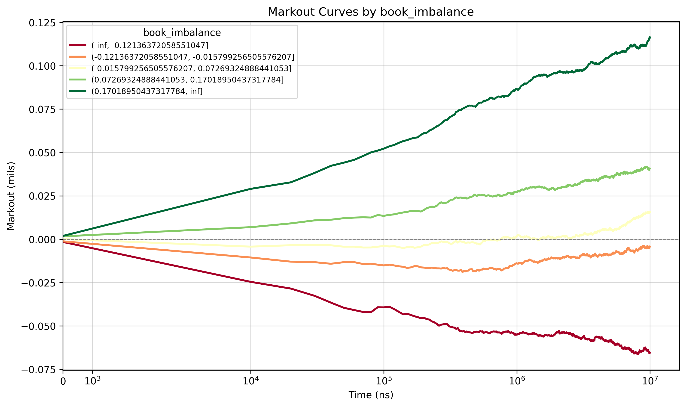{#fig-markout fig-align="center" width=70%}

This plot clearly shows that OBI is a powerful, structural predictor of price direction within a few milliseconds and that this price motion is structural, indicated by the length of time that the markouts stay smooth and near-zero variance. Using this predictive power, our fill strategy can reliably predict positive and negative price drifts and take advantage of them.


# Methodological Choices and Innovations
<!-- Alick -->

## Sourcing Data

We utilize the `MBP-10` schema from Databento, which provides the top 10 levels of the book for a selection of stocks and date range. The dataset includes all order book updates (trades, adds, cancels, etc.) which allows us to reconstruct the book at every book update. The data is sourced from [Databento](https://databento.com/docs/schemas-and-data-formats/mbp-10?historical=python&live=python&reference=python). We fetch data through a simple `DatabentoGenericAdapter` class that uses a hierarchical caching structure. This allows us to call the Databento API only for new information, which is necessary to manage storage and memory for L2 book data. The adapter caches on `[tickers, start, end, dataset, schema]`. Here, our schema is always `MBP-10` and we use the `XNAS.ITCH` Dataset which gives us full access to the Nasdaq exchange.

We use L2 data for three tickers, `AMZN`, `CSCO`, and `DRH` from `"2026-03-18":"2026-04-18"`. We chose these tickers because they cover different varieties of equities. `AMZN` is a liquid small-tick stock that should offer ample resilience to price impact and relatively high and volatile bid-ask spreads. `CSCO` is a liquid large-tick stock that still has deep liquidity but larger spreads and more variability throughout the day. Finally, `DRH` is an illiquid large-tick stock that offers a challenge to minimizing costs. It cannot accept large amounts of liquidity and moves more slowly than `AMZN` and `CSCO`. Put together, this dataset is 28.7GB, on the order of RAM capacity for a sequential process but requires some management for parallel processing tasks, like the below.

## Simulator {#sec-sim}
<!-- Michael CN -->
To allow us to simulate fills using `MBP1-10` data we built an `ExecutionSimulator` class which can:

1. Simulate the execution of market orders, resting limit orders, and immediate-or-cancel (IOC) limit orders at a given nanosecond timestamp and latency.
2. Maintain an orderbook state over time, using L2 data from the `DatabentoGenericAdapter`, consistent with mutations of the book caused by simulated fills and the replenishment of the swept levels via a Poisson process with book-update time sampling.
3. Simulate and track execution statistics (arrival cost, fill times, quantities, etc.) for an arbitrary execution strategy using the above order types.

Our implementation of the `ExecutionSimulator` class initiates the L2 book with a `polars` dataframe in Databento's `MBP-10` schema. The simulator maintains the book using internally consistent `numpy` arrays, which it updates as the book mutates via simulated fills. At the end of a simulation it returns a new `polars` dataframe representing the mutated book over time (sampled at book-update events). After each simulated order is filled (mainly child orders) the simulator returns a dictionary of the form below. Note from @sec-definitions that `arrival_cost` is calculated as the `vwap` minus the mid price at execution.
```{python}
#| output: false
{'vwap': 211.9365352112676,
 'fills': [(211.93, 246), (211.94, 464)],
 'total_filled': 710,
 'levels_swept': 1,
 'executed_at_ns': 1774538471626080001,
 'executed_at_idx': 4078073,
 'arrival_cost': 0.02153521126757596}
```

At each update of the book (sampled from the true data) the book also replenishes any levels swept by simulated fills. To accomplish this it uses a Poisson process to determine the rate of replenishment. When a replenishment occurs at a given level, that level is refilled with a 100 share order for the price the level was previously swept at.

## Strategy Evaluation
To evaluate each of the following strategies, we utilize a parallel processing trial workflow. At initialization, we set the numerous required hyperparameters, each listed below. 

- `Latency = 100us`, `Poisson Replenishment = 15.0`, `PARENT_QTY = 10_000`, `MAX_WORKERS = 10`, `N_TRIALS = 5_000`, `SEED = 12345`, `HORIZON = 300s`

Then we scan the full dataset's parquet cache and split into one `.parquet` for each ticker. We then randomly sample `N_TRIALS = 5_000` initial timestamps from the L2 dataset, ensuring that no two windows from the initial timestamp plus `HORIZON = 300s` seconds overlap more than a few seconds. Then for each combination of ticker and fill strategy, we initialize `MAX_WORKERS = 10` CPU workers and scan the relavent ticker `.parquet` file for each window and run the fill strategy on that window only, randomly choosing the side of the order from `['BUY', 'SELL']`. This workflow balances memory requirements and parallelized processing speed, which brought down the time cost of running trials half an hour per trial sequentially over the full dataset to 5000 trials in a few minutes (depending on the ticker).

To measure the performance of each fill strategy, we save information including `side`, `parent_filled`, `parent_arrival_cost`, `mean_child_arrival_cost`, `median_child_arrival_cost`,  and `parent_lifetime`. Below we compare our final successful strategy with the naive strategy using the above metrics, and go over some failed strategies and their associated learnings along the way. More on specific definitions of the above metrics can be found in @sec-definitions.

## Naive Benchmark
As discussed and plotted earlier, we are comparing our stragies with the naive method of splitting orders into `N_CHUNKS = 50`, and filling them a fixed time interval `WAIT_TIME = 1s` apart using regular market orders. Below in @tbl-naive are some performance metrics for this naive method to serve as a benchmark we are competing against.

```{python}
#| echo: false

import json
import sys
from pathlib import Path
import polars as pl

sys.path.insert(0, str(Path("../code")))
from trials import _trial_cache_key

def load_pair(hybrid_parquet: Path, pre = None):
    """Given a hybrid parquet path, load it and its matching constant parquet."""
    if pre:
      params_path = CACHE_DIR / f"{pre}/{hybrid_parquet.stem}.json"
    else:
      params_path = CACHE_DIR / f"{hybrid_parquet.stem}.json"
    with open(params_path) as f:
        params = json.load(f)

    const_key = _trial_cache_key(**{**params, "method": "constant"})
    if pre:
      const_path = CACHE_DIR / f"{pre}/{const_key}.parquet"
    else:
      const_path = CACHE_DIR / f"{const_key}.parquet"

    hybrid_df = pl.read_parquet(hybrid_parquet)
    const_df = pl.read_parquet(const_path)
    return hybrid_df, const_df, params
```

```{python}
#|echo: false
#|tbl-cap: "Naive Results"
#|label: tbl-naive


# --- pick a parquet to inspect ---
CACHE_DIR = Path("plots_and_data/section_3/latency_data/mid/")
path = CACHE_DIR / "1a9db328aaf8382791779f4075474cee.parquet"

hybrid_df, const_df, params = load_pair(path)
cols = ['parent_filled', 'parent_arrival_cost', 'mean_child_arrival_cost', 'median_child_arrival_cost', 'lifetime_s']
result = const_df.with_columns((pl.col("lifetime_ns") / 1e9).alias("lifetime_s")).select(cols).describe().rename({'parent_arrival_cost': 'parent_cost', "mean_child_arrival_cost": "mean_child_cost", "median_child_cost": "median_child_cost", 'parent_filled': 'total_filled'})

result.filter(pl.col("statistic").is_in(['mean', 'min', '25%', '50%', '75%', 'max']))
```


## Failure: Naive with IOC
The first pass attempt to improve on the benchmark is simply running the same strategy using marketable IOC limit orders instead of market orders. Results below in @tbl-naive-ioc. We used the `DEPTH_LMT = "09"` parameter to set the limit price of each child order to the 10th level of the ask (bid) for a parent buy (sell) order at the initial time of execution. This resulted in better fills, however it almost never completed hte full parent order given it's simple cap on the allowed execution price.

```{python}
#|echo: false
#|tbl-cap: "Naive IOC Results"
#|label: tbl-naive-ioc

# --- pick a parquet to inspect ---
CACHE_DIR = Path("plots_and_data/section_2/failed_runs/")
path = CACHE_DIR / "3890ab215531e0d7c7cf3bc62ae6bf40.parquet"

hybrid_df, const_df, params = load_pair(path)
cols = ['parent_filled', 'parent_arrival_cost', 'mean_child_arrival_cost', 'median_child_arrival_cost', 'lifetime_s']
result = const_df.with_columns((pl.col("lifetime_ns") / 1e9).alias("lifetime_s")).select(cols).describe().rename({'parent_arrival_cost': 'parent_cost', "mean_child_arrival_cost": "mean_child_cost", "median_child_cost": "median_child_cost", 'parent_filled': 'total_filled'})

result.filter(pl.col("statistic").is_in(['mean', 'min', '25%', '50%', '75%', 'max']))
```

## Failure: OBI Aggressive Only
Beyond simply tweaking the benchmark our first true pass at an improvement used OBI to time our fills using the parameter `OBI_THRESHOLD = 0.85`. First, set the maximum size of a child fill at $q_{max}$. For a buy order, if the OBI was above the threshold that indicated an expected upward price move, the logic is to fill a child order immediately of size $q_{max} * |OBI|$, where $q_{max} = 350$. This would dynamically size orders based on the size of the subsequent price moves, and attempt to only fill at advantageous times. @fig-obi shows this strategy in action. 

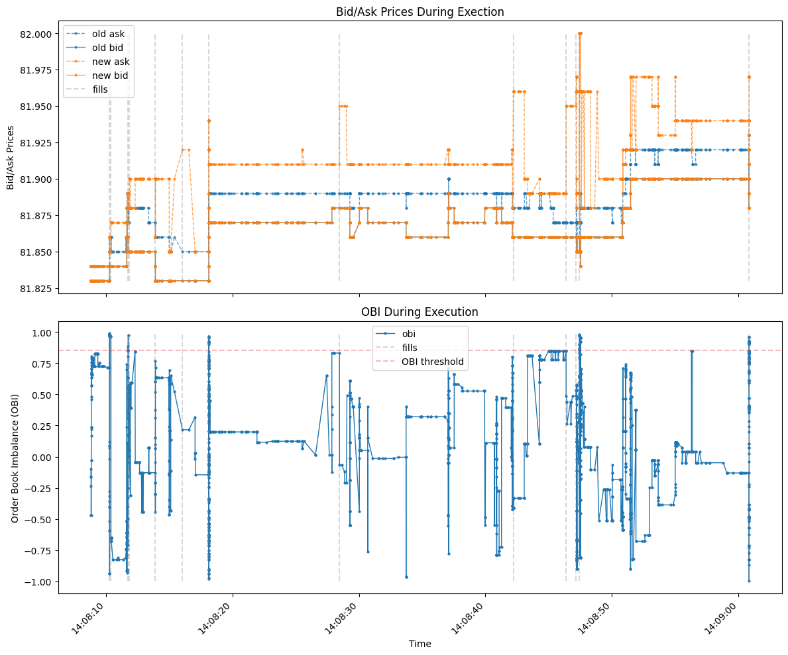{#fig-obi fig-align="center" width=70%}

This strategy had a few issues. Firstly, for some time horizons, OBI infrequently or simply never hits the threshold it and so the parent order only gets a partial fill. More fundamentally, this logic only seeks to avoid adverse fill conditions, and does nothing explicit to take advantage of favorable ones. 

The aggressive-only OBI logic originated from a way of thinking rooted in alpha generation and the predict returns to be exploited by taking an aggressive position. But returns are exactly *not* what an execution strategy is focused on: simply put, to take advantage of alpha a strategy must enter and exit a position, but an execution strategy is *given* a predetermined order to place and its task is to minimize the cost filling the order's quantity over a set time horizon. Solving the second issue via this change of perspective lead directly to our improvement via a hybrid strategy.

## Final Strategy: Hybrid OBI Calibrated Aggression
<!-- Michael CN -->
After escaping the alpha generation line of thinking, we were able to develop a much more effective fill strategy. It is a hybrid of the naive and OBI strategies that uses OBI to calibrate the aggressiveness or urgency of fills. For a parenty order of quantity $q$ logic is as follows:

1. Split the parent order into $n$ child orders of size $q/n$. 
2. Set positive and negative OBI thresholds for expected price moves that are calibrated using the markout plots above.
3. For a buy order, depending on the value of OBI, do the following (oppsite for a sell):
  - If OBI > `OBI_THRESHOLD`, expect an adverse price move. Fill one child order immediately. Cross the spread with an IOC limit order wiht limit price set to the 10th level of the book at the time the parent order was split.
  - If OBI < -1 * `OBI_THRESHOLD`, expect a favorable price move. Place resting limit orders at each of the top ten bids, each for the quantity of one child order. Set expiry at the end of the parent order's allowed horizon.
  - If OBI is between the above thresholds, fill child orders with IOC limit orders at a slow constant rate with the same limit price.

By calibrating the aggression of child orders and allowing the price to drift, this strategy fills the vast majority of shares during favorable price conditions, and avoids unfavorable ones by filling immediately and then not at all until the price moves favorably again. This is illustrated in @fig-hybrid, which shows the true and simulated bid and ask overtime with favorable and adverse price drifts highlighted using the value of OBI. The verticle gray markers are the timestamps of each child fill. Note that limit orders placed when OBI is low may fill when OBI is high, resulting in lots of fills during times marked "unfavorable". This is positive and expected behavior.

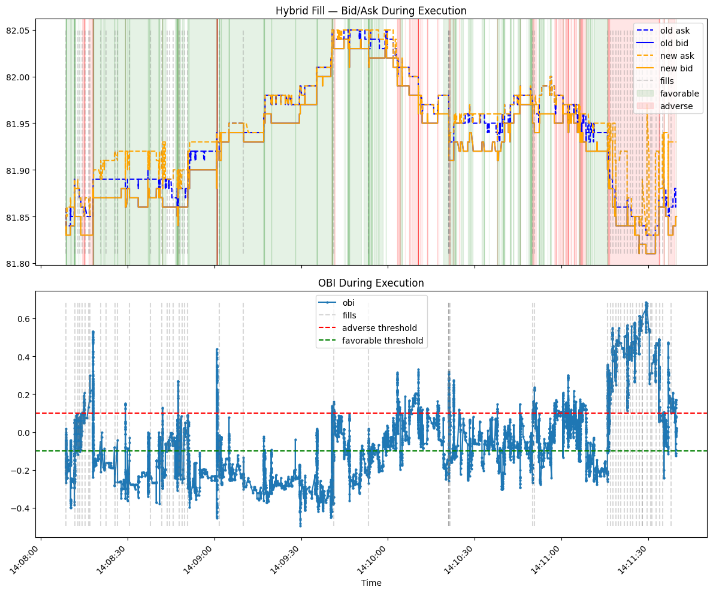{#fig-hybrid fig-align="center" width=70%}


# Empirical Findings
<!-- Michael B -->
@tbl-success shows some descriptive statistics of the results of the hybrid fill strategy, by asset. The parent costs are measured in bps per share. These results are derived from running the strategy across assets for 5000 timestamps, latency of `100us`, replenishment rate of $15$, a time horizon of $5$ minutes, and splitting a 10,000 share parent order into $n=50$ child orders each with quantity $q=200$ with OBI thresholds of $\pm 0.10$. 

The average parent order's total cost, defined in @sec-definitions, is highly dependent on the liquidity of each stock, with `DRH` and `CSCO` fills being respectively 141x and 9x times more costly than `AMZN` on average. This is likely the result of illiquidity causing child orders to have higher mechanical price impact, and methods to improve this are considered in @sec-future. The order lifetimes are relatively consistent at approximately thirty seconds for the liquid stocks, and above a minute for illiquid. All hybrid fills were completed withing the 5 minute horizon. @fig-hist shows histograms of the total parent cost per asset. Here it is visually obvious that the naive method has a heavy right tail, while the hybrid strategy has a mean shift downward and heavy left tail.

::: {#fig-hist layout-ncol=3}

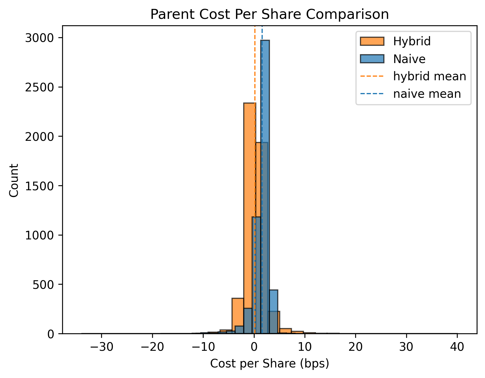{#fig-hybrid fig-align="center" width=100%}

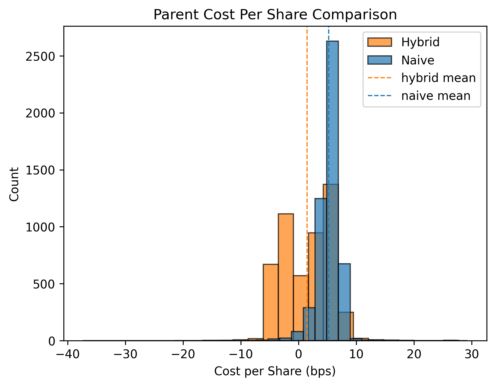{#fig-hybrid fig-align="center" width=100%}

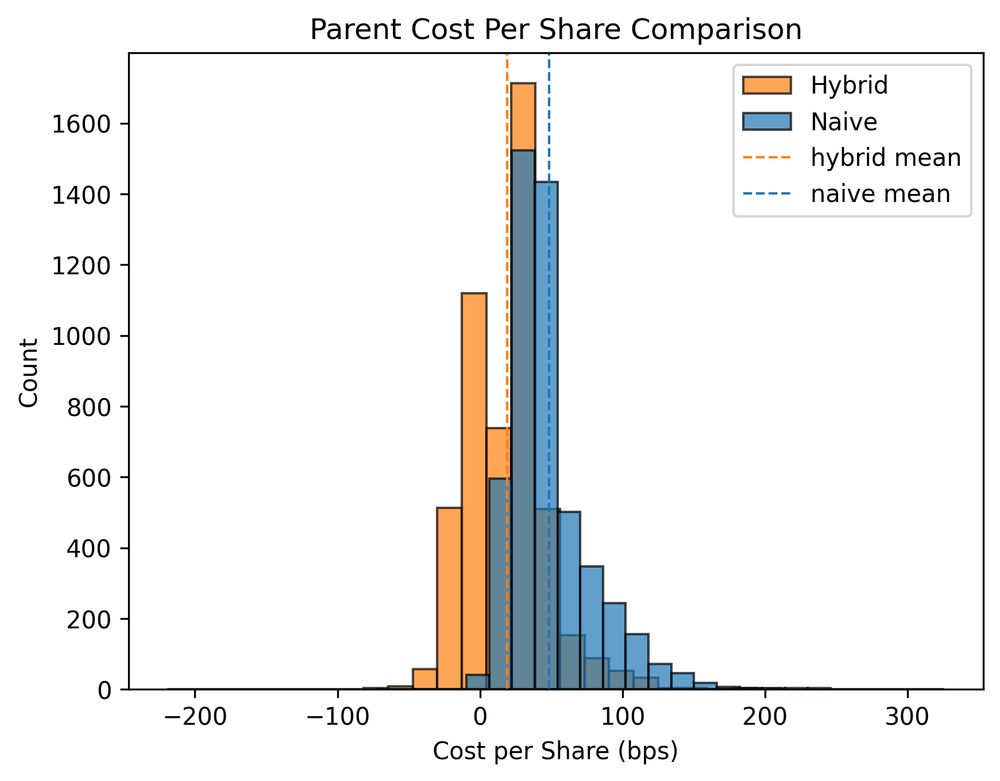{#fig-hybrid fig-align="center" width=100%}

Total Parent Cost Comparison
:::
```{python}
#| echo: false
#| tbl-cap: "Hybrid Fill Statistics"
#| layout: [[47.5, -5, 47.5], [100]]
#| label: tbl-success
#| tbl-subcap: 
#|    - "AMZN"
#|    - "CSCO"
#|    - "DRH"

#=============
#    AMZN
#=============
from IPython.display import Markdown, display
# layout: [[35, -30, 35], [100]]

# --- pick a parquet to inspect ---
CACHE_DIR = Path("plots_and_data/section_3/successful_run/cost_data")
path = CACHE_DIR / "204b0a2f144401b56ae861cbac7ec2a6.parquet"

hybrid_df, const_df, params = load_pair(path)
cols = ['parent_arrival_cost', 'lifetime_s']
result = (
  hybrid_df
  .with_columns((pl.col("lifetime_ns") / 1e9).abs().alias("lifetime_s"))
  .select(cols)
  .describe()
  .rename({'parent_arrival_cost': 'parent_cost'})
)

display(result.filter(pl.col("statistic").is_in(['mean', 'std', '50%'])))

#=============
#    CSCO
#=============

# --- pick a parquet to inspect ---
CACHE_DIR = Path("plots_and_data/section_3/successful_run/cost_data")
path = CACHE_DIR / "1a9db328aaf8382791779f4075474cee.parquet"

hybrid_df, const_df, params = load_pair(path)
result = (
  hybrid_df
  .with_columns((pl.col("lifetime_ns") / 1e9).abs().alias("lifetime_s"))
  .select(cols)
  .describe()
  .rename({'parent_arrival_cost': 'parent_cost'})
)

display(result.filter(pl.col("statistic").is_in(['mean', 'std', '50%'])))

#=============
#    DRH
#=============

# --- pick a parquet to inspect ---
CACHE_DIR = Path("plots_and_data/section_3/successful_run/cost_data")
path = CACHE_DIR / "9a484a1ba943b069d31bbc4aeb70b1a7.parquet"

hybrid_df, const_df, params = load_pair(path)
result = (
  hybrid_df
  .with_columns((pl.col("lifetime_ns") / 1e9).abs().alias("lifetime_s"))
  .select(cols)
  .describe()
  .rename({'parent_arrival_cost': 'parent_cost'})
)

display(result.filter(pl.col("statistic").is_in(['mean', 'std', '50%'])))
```

## Test Stats / Significance
@tbl-tstat shows the average cost in bps per share, per ticker, using the hybrid and naive fill strategies, as well as the results of a two-sample T-test on per asset samples. The hybrid strategy shows a pronounced downward shift in cost accross assets, with improvements of 89% for `AMZN`, 73% for `CSCO`, and 55% for `DRH`. Each of these results is also highly significant.
```{python}
#| echo: false
#| tbl-cap: "T-Test on Arrival Cost per Asset"
#| label: tbl-tstat

from scipy import stats
# --- pick a parquet to inspect ---
CACHE_DIR = Path("plots_and_data/section_3/successful_run/cost_data")
hybrid_paths = [
  "204b0a2f144401b56ae861cbac7ec2a6.parquet", # AMZN
  "1a9db328aaf8382791779f4075474cee.parquet", # CSCO
  "9a484a1ba943b069d31bbc4aeb70b1a7.parquet"  # DRH
]
tickers = ["AMZN", "CSCO", "DRH"]
data = []
for p, ticker in zip(hybrid_paths, tickers):
  path = CACHE_DIR / p
  hybrid_df, const_df, params = load_pair(path)
  t_stat, p_val = stats.ttest_ind(
      const_df['parent_arrival_cost'],
      hybrid_df['parent_arrival_cost'],
      equal_var=False
  )
  h_mean = hybrid_df.select("parent_arrival_cost").mean().item()
  c_mean = const_df.select("parent_arrival_cost").mean().item() 
  data.append({
    "symbol": ticker,
    "hybrid mean": round(h_mean, 2),
    "naive mean": round(c_mean, 2),
    "t_stat": round(t_stat, 2),
    "p_val": round(p_val, 2)
  })

df = pl.DataFrame(data)
df

```

## Effects of Latency and Replenishment
In @tbl-latency and @tbl-replenishment we demonstrate the hybrid strategy's robustness to latency and replenishment. Here, latency is implemented as the delay between the time each child order is sent vs when it enters the book, and is displayed in microseconds. The bps per-share cost differences between levels of latency are remarkably low across assets and strategies. This is obvious for the naive strategy as it is zero-intelligence. The hybrid strategy does have some reliance on latency when filling with an IOC order immediately before adverse moves, however the majority of fills are from resting limit orders filling over multiple seconds and so it remains robust to changes in latency.

The effects of replenishment are also small but are more clear than latency. Across strategy and asset, a higher rate of replenishment leads to a slightly lower average cost and vice versa. This is simply calibration of the books liquidity, and demonstrates a sanity check on the fill results and the hybrid strategy's robustness to the value of hyperparameters.

```{python}
#| echo: false
#| tbl-cap: "Effects of Latency"
#| label: tbl-latency

from scipy import stats
# --- pick a parquet to inspect ---
CACHE_DIR = Path("plots_and_data/section_3/latency_data/")
hybrid_paths = [
  ("low/974b77b083e087c8108ea24d5563cd48.parquet", "CSCO", "low"),
  ("low/d41ed8fb8e47884319c37084fd0ec75b.parquet", "AMZN", "low"),
  ("low/ffe336bd7988eb97dddbf75e84c6c70b.parquet", "DRH", "low"),
  ("mid/1a9db328aaf8382791779f4075474cee.parquet", "CSCO", "mid"),
  ("mid/204b0a2f144401b56ae861cbac7ec2a6.parquet", "AMZN", "mid"),
  ("mid/9a484a1ba943b069d31bbc4aeb70b1a7.parquet", "DRH", "mid"),
  ("high/3b5c8345540b60d6426d65d003194198.parquet", "CSCO", "high"),
  ("high/53e91660acfad69b26d1ae8488873cbd.parquet", "AMZN", "high"),
  ("high/8389ddf3b43f1b774545cbba8b2bfa2e.parquet", "DRH", "high")
]
data = []
for p, ticker, level in hybrid_paths:
  path = CACHE_DIR / p
  hybrid_df, const_df, params = load_pair(path, pre=level)

  h_mean = hybrid_df.select("parent_arrival_cost").mean().item()
  c_mean = const_df.select("parent_arrival_cost").mean().item() 
  data.append({
    "symbol": ticker,
    "latency_level": level,
    "hybrid mean cost": round(h_mean, 2),
    "naive mean cost": round(c_mean, 2),
    "latency (us)": params['latency'] / 1000,
  })

df = pl.DataFrame(data)
df
```

```{python}
#| echo: false
#| tbl-cap: "Effects of Replenishment"
#| label: tbl-replenishment

from scipy import stats
# --- pick a parquet to inspect ---
CACHE_DIR = Path("plots_and_data/section_3/replenishment_data/")
hybrid_paths = [
  ("low/066d1d787a1148b4a53c40a6c8a750ba.parquet", "CSCO", "low"),
  ("low/13675423747362b1fad48b2114aaa90e.parquet", "AMZN", "low"),
  ("low/f8b9be218d00a20bbe473e0a6bfc3ff7.parquet", "DRH", "low"),
  ("mid/1a9db328aaf8382791779f4075474cee.parquet", "CSCO", "mid"),
  ("mid/204b0a2f144401b56ae861cbac7ec2a6.parquet", "AMZN", "mid"),
  ("mid/9a484a1ba943b069d31bbc4aeb70b1a7.parquet", "DRH", "mid"),
  ("high/7d4a20358146ccd196c803b3ce6457b7.parquet", "CSCO", "high"),
  ("high/f63705aff422d1ddcff2de13cfc8929e.parquet", "AMZN", "high"),
  ("high/6c8044c9d680d3a7f5b0b372f5bb6fa7.parquet", "DRH", "high")
]
data = []
for p, ticker, level in hybrid_paths:
  path = CACHE_DIR / p
  hybrid_df, const_df, params = load_pair(path, pre=level)

  h_mean = hybrid_df.select("parent_arrival_cost").mean().item()
  c_mean = const_df.select("parent_arrival_cost").mean().item() 
  data.append({
    "symbol": ticker,
    "replenishment_level": level,
    "hybrid mean cost": round(h_mean, 2),
    "naive mean cost": round(c_mean, 2),
    "replenishment": params['replenishment'],
  })

df = pl.DataFrame(data)
df
```

## Intraday Seasonality
@fig-time shows the intraday seasonality of median arrival cost in bps per-share, across ticker sand strategies. As expected both strategies, though especially the hybrid, benefit from the high volume on the open, and approach a mean throughout the day. Interestingly, the naive strategy does worst during the open for DRH. This could be a result of high opening spreads for the illiquid asset, which then stabilize to one or two ticks overtime.

::: {#fig-time layout="[[1,1], [1]]"}

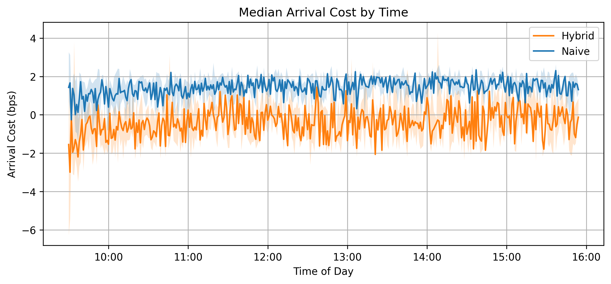{#fig-time-amzn fig-align="center"}

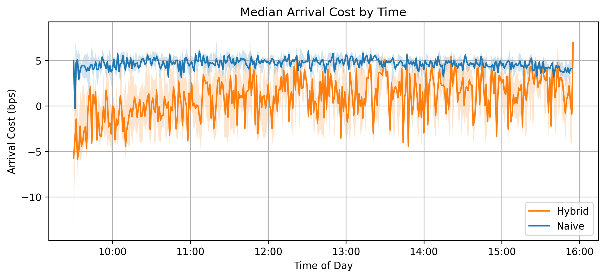{#fig-time-csco fig-align="center"}

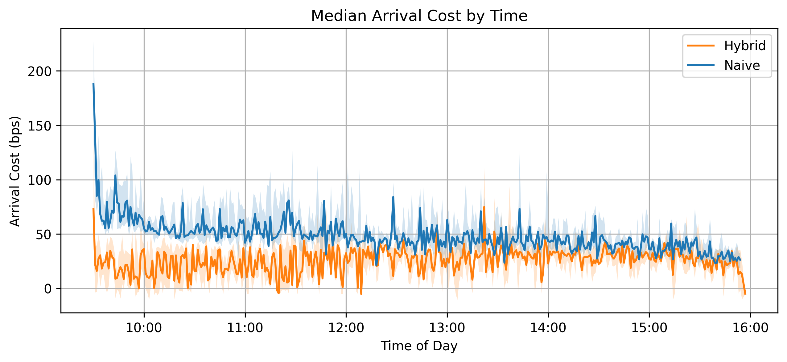{#fig-time-drh fig-align="center" width=52%}

Intraday Seasonality of Arrival Cost
:::

# Future Work {#sec-future}
<!-- Debby -->
A few improvements stand out with their potential to improve upon the hybrid fill strategy. They are laid out below.

## EMA of Book Imbalance
To prevent temporary peaks in book imbalance from changin the strategy's aggression, the strategy ould use a moving average of book imbalance. This would smooth the peaky nature of OBI. HOwever, this introduces yet more hyperparameters and is linked with the time to expiry of resting limit orders.

## Catch-Up Mechanism
Currently, the strategy is placing naive IOC orders when OBI is not strongly indicating the direction of price drift, which can cause unnecessary price impact. This could be improved by implementing a mechanism to measure how ahead or behind the strategy is in its filled quantity and dynamically tweak the OBI thresholds or size of fills.

## Horizon as a Function of Volume
Currently the hybrid strategy uses a set hyperparameter for the parent order's horizon to fill. This could be dynamically chosen as a function of the share or dollar volume in the past few minutes, indicating how much impact the fills are likely to have. With more volume being traded, the time horizon can be shorter and vice-versa.




# Definitions and Appendix {#sec-definitions}
Throughout this work we refer to a few concepts that require specific definitions. We lay them out below for reference.
<!-- Vijeet --> 

- OBI: We define order book imbalnce (OBI) using the top *six* levels of the book, as follows:
$$
\begin{split}
OBI = \frac{\Sigma_{i=0}^5 Q_{i}^{bid} - \Sigma_{i=0}^5 Q_{i}^{ask}}{\Sigma_{i=0}^5 [Q_{i}^{bid} + Q_{i}^{ask}]}\in [-1, 1]
\end{split}
$$ {#eq-obi}

- Price Impact : When referring to price impact we inlcude only the mechanical impact of taking liquidity from the limit order book. Below is a visualization of the mechanical impact for reference. Our order book simulation is discussed in @sec-sim, and includes further information on impact as well as replenishment and latency.
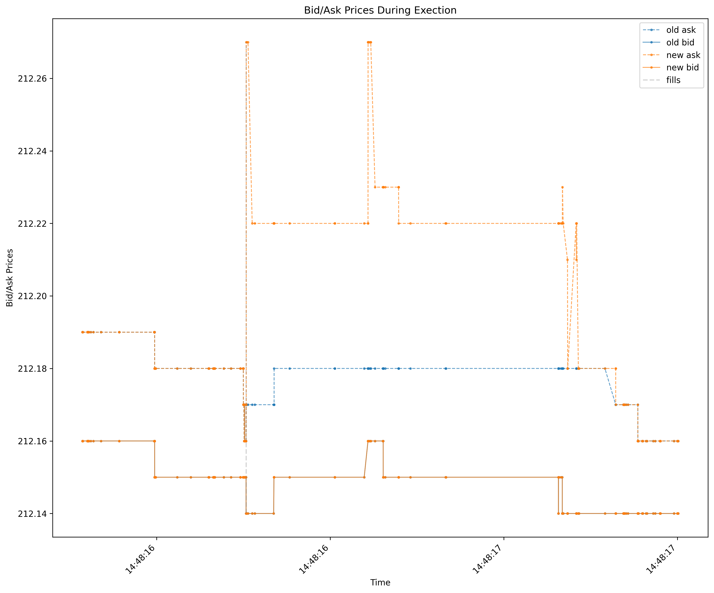{#fig-impact fig-align="center" width=70%}
- Arrival Cost: When referring to arrival cost of a parent or child order, we are referring to the volume-weighted average price of a fill minus the mid price at the time of execution, divided by mid price and converted to bps. For a parent order, the VWAP sums over child order's individual vwaps in the same way, and the mid price is set to the price at the time the parent order sent to the execution engine. For child orders, the mean and median arrival costs are calculated across child orders for a given parent. Below, $q_i$ and $p_i$ are the individual fill's quantities and prices respectively.
$$
\begin{split}
p_{vwap} &= \frac{\Sigma_{i=0}^nq_i\,p_i}{\Sigma_{i=0}^nq_i}\\ 
\text{ArrivalCost (bps)} &= \frac{p_{vwap} - p_{mid}}{p_{mid}} * 10^4
\end{split}
$$ {#eq-vwap}

# References

- Bouchaud, J. P., Farmer, J. D., & Lillo, F. (2009). How markets slowly digest changes in supply and demand. *Handbook of Financial Markets*.
- Cont, R., Kukanov, A., & Stoikov, S. (2014). The price impact of order book events. *Journal of Financial Econometrics*.
- Said, E. (2022). Market Impact: Empirical Evidence, Theory and Practice. *arXiv preprint*.
- Sato, Y., & Kanazawa, K. (2024). Online Learning of Order Flow and Market Impact with Bayesian Change-Point Detection Methods. *arXiv preprint*.
- Obizhaeva, A. A., & Wang, J. (2013). Optimal trading strategy and supply/demand dynamics. *Journal of Financial Markets*, 16(1), 1–32.
- Gârleanu, N., & Pedersen, L. H. (2013). Dynamic trading with predictable returns and transaction costs. *Journal of Finance*, 68(6), 2309–2340.